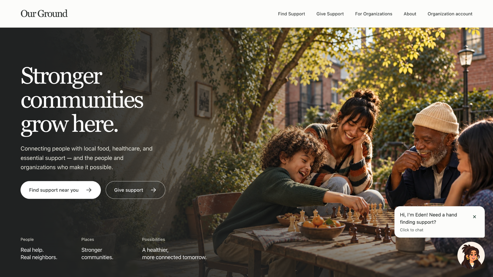
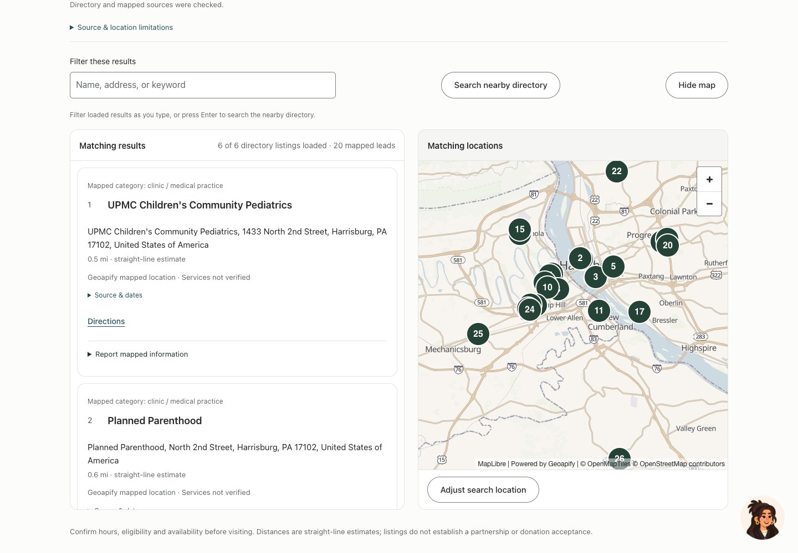
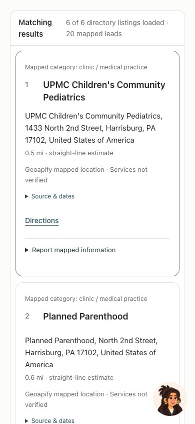

# Our Ground

A student-built resource directory that helps people find food, healthcare, and community support, with **Eden**, a page-aware Gemini assistant.

[Visit Our Ground](https://ourground.vercel.app) · [Architecture](docs/ARCHITECTURE.md) · [Contributing](CONTRIBUTING.md) · [Security](SECURITY.md)



## Find support, then understand the next step

Search a U.S. city or ZIP code, filter nearby listings, and explore the results on a map. Each listing preserves its source and verification context so visitors can check information with the provider.

Eden supports text conversation, consent-based **Talk to Eden** voice calls, **Read reply**, and device dictation where supported. Her visible cursor follows authorized page actions, including searches and opening a current result. Manual search and navigation work independently of the assistant.

- **Residents** can discover resources and inspect practical details and provenance.
- **Donors** can explore giving information and follow provider links.
- **Organizations** can view their public information and sign in with Google. Privileged management is currently disabled in production. Scoped editing and reviewed changes are implemented and tested in staging.



<details>
<summary>Mobile directory</summary>



</details>

## Engineering

- **TypeScript and Vite** serve the responsive interface.
- **Vercel Functions** validate requests and expose the application API.
- **Supabase PostgreSQL/PostGIS** support geographic search, public projections, and organization authorization. Supabase Auth handles Google PKCE sign-in.
- **Gemini** powers bounded text decisions and Live voice. Permanent provider credentials remain server-side. Live uses short-lived, single-use credentials and verified public-page tools.
- **MapLibre and Geoapify** provide the map experience. Census references support city and ZIP resolution.

See the [architecture and trust boundaries](docs/ARCHITECTURE.md) for the data flow and operational limits.

## Run locally

Use Node **24.x** and the committed lockfile.

```sh
npm ci
npm run dev:local:api
```

In another terminal:

```sh
npm run dev:local:web
```

Open `http://127.0.0.1:18417/`. This mode uses clearly labeled fictional records. Real database, authentication, maps, and Gemini require separately configured services. Use [`.env.example`](.env.example) as the configuration template. Keep server credentials out of browser-prefixed variables and source control.

```sh
npm test
npm run build
npm run check:secrets:build
```

CI also exercises database privacy boundaries and browser interactions. Recorded production verification includes real Gemini text and voice, resource actions, map rendering, and Google sign-in, natural refresh, and logout. Accessibility evidence includes automated checks and owner-performed Safari/VoiceOver acceptance.

## Scope and responsible use

The live site is for adults **19 and older**. Eden’s hosted AI is restricted to eligible U.S. access and bounded free-tier capacity. Voice requires explicit microphone consent. Avoid personal, medical, financial, or other sensitive details. Live microphone audio goes directly to Google during the call, subject to the displayed provider disclosure.

Directory coverage varies by area. Imported listings and mapped leads do not establish current availability, independent verification, a partnership, or eligibility for a service. Confirm details with the organization. Our Ground provides resource navigation and does not provide medical advice or process donations.

## Contributors and rights

Maintained and developed by **Penuel Stanley-Zebulon** ([iampenuel](https://github.com/iampenuel)). The repository also includes the original project and backend-verification contributions from [JasurbekElmuratov](https://github.com/JasurbekElmuratov). See [credits](CREDITS.md) for contributor and third-party attribution details.

This repository showcases a finished application. No repository-wide license is currently specified. Third-party code, data, images, and branding retain their applicable terms. The included [ReactDrops license](src/eden/reactdrops/LICENSE.txt) permits integrated end products and restricts redistribution as reusable development assets. Publishing this project does not relicense those components.
