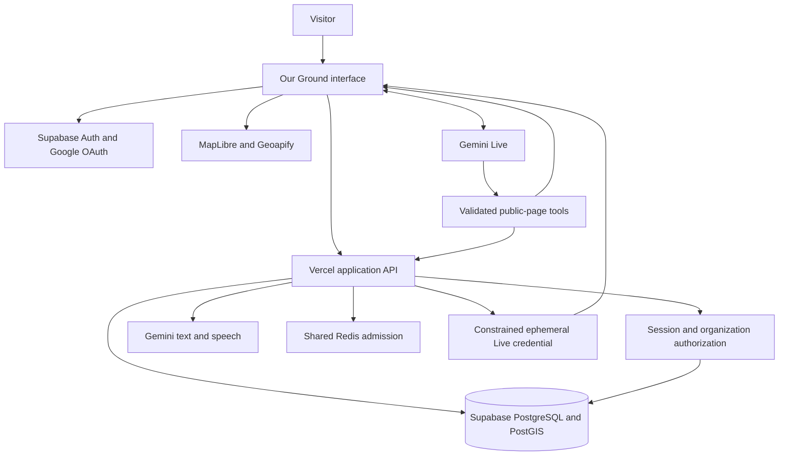

# Architecture

Our Ground combines a TypeScript/Vite interface, a validated application API, a geographic directory, managed authentication, and the Gemini-powered Eden assistant. This overview describes the released implementation. Earlier proposals and dated engineering notes may describe older behavior.

## Directory and interface

The browser renders the homepage, support search, giving and organization information, account screens, and resource details. Same-origin API routes are handled before the frontend fallback.

The API validates locations, query fields, identifiers and limits. PostgreSQL/PostGIS performs geographic search. Public projections exclude private account information and synthetic fixtures. Listings preserve source bindings and verification context, while supplementary mapped leads remain separately labeled.

Census references provide representative city and ZIP points. Optional geocoding and map services have independent configuration and budgets. A failed real service does not silently switch to fictional records. The results list remains usable when the map is unavailable.

## Eden and authorized actions

Typed conversation uses bounded semantic input and approved public-page context. Gemini works within explicit capabilities. The server validates a proposed action and the relevant records, then the application executes and reconciles the outcome before replying.

The visible cursor represents that application action. It does not give Gemini arbitrary DOM, navigation, account-editing, payment, or submission authority. Search, refinement and detail actions use the same capabilities as manual controls. Fresh context and verified outcomes support follow-up questions.

Read reply uses a separate speech endpoint and one-use reply ticket. Device dictation drafts text where supported. A device voice is an explicit user choice.

## Live voice

Talk to Eden requires age acknowledgment, the AI disclosure, and microphone consent. The server checks admission and mints a short-lived, single-use credential constrained to the approved model and configuration. The browser connects directly to Gemini Live. The permanent provider key remains on the server.

The browser forwards microphone frames, plays returned audio, and handles transcription, interruption, timeouts and tool calls. Each accepted function call receives its matched result after the public action is verified. Completed navigation must still be followed by the conversational response.

End Call stops capture and playback and closes the socket. The provider seat remains reserved until credential expiry because the application cannot revoke it at Google. The current call ceiling is ten minutes. Longer continuous sessions are not qualified.

## Authentication and organization access

Supabase Auth handles Google sign-in with PKCE and exact origins and callbacks. A publishable browser key provides no privileged database access. Private operations require a verified session, current account status, organization membership and listing assignment. Database policies restrict direct access to private relations.

The implemented organization workflow supports claims, versioned proposals, independent review and audit records. Production currently allows ordinary sign-in while closing management APIs, including legacy aliases. Assigned editing, isolation and revocation were verified in staging. Google authentication alone grants no organization or administrator role.

## Privacy, capacity and release checks

The signed adult acknowledgment is separate from account authentication. The live site is for adults 19 and older. Hosted AI also has region and provider-eligibility gates.

Shared admission controls bound text, speech, discovery and Live independently. Live includes global and per-browser budgets, concurrency reservations and a short-lived keyed network digest for burst admission. These controls do not guarantee provider availability.

Typed context is restricted to approved information. During a consented call, microphone audio goes directly to Google and cannot promise pre-transmission redaction. The application normally keeps conversation state in bounded memory and does not persist raw microphone audio. Google's processing terms are disclosed separately.

Server secrets belong in managed server configuration. Browser-prefixed variables may contain only intentionally public configuration, such as a publishable Auth key or restricted map key. Operational receipts and authentication evidence require separate review before publication.

CI covers builds, secret boundaries, database privacy, authorization and browser journeys. Production qualification additionally used real Gemini interactions and Google exchange, refresh and logout. Physical Safari/VoiceOver acceptance is owner-reported evidence. Production candidates are fingerprinted against their source and tested before promotion. Checked-in Vercel configuration disables automatic Git deployment.
