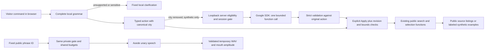

# EDEN-03 — page-aware assistant

> **Historical implementation record:** Later corrections restore the original Our Ground product and require genuine Gemini-powered Eden, without a non-AI guide substitute. Both `/eden` and `/eden-assistant.html` redirect to `/support`; eligible testing uses the original app in explicit local review mode. Use [current architecture](current-architecture.md) and [current verification](verification/restored-product.md). Preserve earlier engineering/live evidence below without treating its UI or command-guide behavior as current acceptance.

> **Superseded intermediate revision:** A later standalone `/eden` showcase and reviewer-gated comparison were implemented between EDEN-03 and the restoration. The owner rejected that presentation. Its [architecture history](showcase-and-reviewer-access.md) is retained; the current product is described in the [repository README](../../README.md).

Implementation and evidence date: **2026-11-06**. This document supersedes EDEN-02's provider-selection recommendation for the owner's new adult-focused competition/portfolio scope. Gemini Developer API free tier and Aoede are the only implemented external AI options. No OpenAI, Azure, paid service, billing setup, deployment or production configuration change was made.

## Decision and current behavior

**GO for local deterministic navigation and synthetic testing. Conditional GO for an operator-authorized private synthetic Gemini evaluation after account, region and free-tier eligibility are established. NO-GO for public Gemini.** A checkbox, API key or adult-oriented label cannot satisfy the independent API-client audience restrictions. No legal compliance, DPA, BAA or HIPAA approval is certified.

The floating Eden guide is mounted on `/` and `/support`, alongside the existing discovery experience. It has a responsive, keyboard-accessible panel, approved portrait, animated states, explicit action review, concise privacy controls, local error recovery and text fallback. Account, staff, authentication and giving workflows have no assistant. Closing or clearing ends the assistant session without erasing the site's current public search.

The working example `EDEN, find food assistance in Harrisburg.` becomes a canonical city/category action locally. After **Apply**, it changes the real search form and invokes the existing search flow. On the homepage it navigates using only canonical public city/category/radius parameters. On Find Support it updates the existing page in place. The isolated demo uses exactly this page adapter with fictional records and an offline MapLibre map. Synthetic examples never acquire real contact, directions, donation or reporting actions.

The UI truthfully labels local guidance and Gemini-checked proposals. Gemini contributes a bounded function-call proposal for the already approved action; it does not interpret raw visitor text, invent listings, generate navigation advice or choose additional actions. This narrow capability is intentional. Template responses report actual application outcomes and source uncertainty. The assistant does not claim listings are verified services or establish availability.

The owner configured a server-only key and explicitly confirmed an adult US operator, an unbilled free-tier project, and local synthetic testing. A real Gemini function-call proposal and Aoede playback then succeeded in the isolated demo. Those operator attestations and observed calls are not an independent billing audit or public eligibility approval. Private flags were enabled only in a temporary loopback process; persisted configuration remains disabled. No simulated text is presented as a real model response.

## Run locally

Use Node **24.x** (`.nvmrc`). After `npm install`, run in separate terminals:

```sh
npm run dev:eden:api
npm run dev:eden:assistant
```

Open **http://127.0.0.1:5199/eden-assistant.html**. The API binds only to `127.0.0.1:8789`; the demo proxies its EDEN routes. Resource/location fixtures are entirely browser-local, visibly synthetic and have no live directory or basemap dependency. Default Gemini mode is disabled, so no key is needed for the full navigation demonstration. `npm run dev` still starts the normal application independently.

Try these complete commands and review each proposed action before applying it:

1. `EDEN, find food assistance in Harrisburg.`
2. `Change radius to 25 miles`
3. `Show healthcare resources`
4. `Select result 2 on the map`
5. `Open details for result 1`

The bounded city list currently includes Harrisburg, Philadelphia, Pittsburgh, Lancaster, New York, Baltimore, Washington DC, Boston, Chicago, Detroit, Atlanta and Los Angeles. Other cities and precise addresses use the existing location controls; they are not extracted from arbitrary text. Ambiguous, unavailable, out-of-range or unsupported commands receive local clarification. App results must be loaded before numbered actions can execute.

For a later private live evaluation, the **operator**, after reviewing [current provider evidence](eden-03-provider-evidence.md), may configure the server-only `.env.local` values below. Do not paste credentials into chat, commit them, create a `VITE_` key, associate paid billing, purchase credits or change production settings.

```dotenv
GEMINI_API_KEY=<operator-provided private key from a confirmed free project>
EDEN_GEMINI_MODE=synthetic-development
EDEN_GEMINI_FREE_TIER_CONFIRMED=true
EDEN_GEMINI_TEXT_MODEL=gemini-3.5-flash-lite
EDEN_GEMINI_TTS_ENABLED=false
EDEN_GEMINI_TTS_MODEL=gemini-3.8-flash-lite-tts
EDEN_DEVELOPMENT_ORIGINS=http://127.0.0.1:5199,http://localhost:5199
```

Restart the dedicated API. In the local demo's **Prototype privacy & voice** disclosure, explicitly acknowledge age and privacy, then enable the private session. Both confirmations are required server-side. For an independently approved speech test, enable `EDEN_GEMINI_TTS_ENABLED=true`, restart the API, explicitly unmute and choose **Read aloud**. It reads a fixed public phrase; it does not read the conversation, location or resource record. No voice is generated automatically.

`EDEN_GEMINI_FREE_TIER_CONFIRMED` is an operator attestation, not an SDK account/billing audit. The implementation cannot prove an API key is unbilled or that the operator is in a permitted country. Do not set this flag without that evidence. The public gate cannot be opened by setting an environment flag; hosted/production execution is independently denied.

## Implemented boundaries

| Boundary | Implemented behavior | Evidence |
| --- | --- | --- |
| Local input | Full-input finite grammar, 240-character cap, canonical cities, fixed categories/radii/indices; sensitive or extra clauses cannot yield a partial action. Original input is cleared after review and never reflected into history. Redaction is not the safety boundary. | `shared/eden-assistant.ts`; interpreter tests |
| Provider projection | Only validated `action` and `{page,category?,radius?,resultCount,synthetic}` plus a notice version. City is removed even when public. No DOM, URL, account ID, name, description, address, coordinates, original query, voice or chat history. Real-data contexts are denied by the provider service. | Shared validators; `application-bridge.ts`; provider tests |
| Application authority | Typed public page adapter, strict action validation, current revision and result bounds. Explicit Apply. Existing search, details and selection functions execute. No browser automation, arbitrary selectors, code, URL tools or account capabilities. | Bridge and support adapter; application tests |
| Model result | Exactly one allowlisted function call with arguments equal to the approved action. Prose, changed parameters and additional calls fail closed. The model's response never supplies resource facts or executable code. | `backend/eden-provider.ts` |
| Secrets and SDK | Official `@google/genai` **3.0.0**, server-runtime import only; pinned Google endpoint; no browser SDK/key, Vertex or enterprise routing; allowlisted free-compatible models. | Runtime wiring and production bundle checks |
| Public denial | Public/hosted requests denied independently of acknowledgments or a public-enable flag. Private mode also needs exact loopback URL and allowed Origin, configured key, free-tier confirmation, current notice and expiring origin-bound EDEN session. Account Bearer tokens are not accepted. | `backend/eden-api.ts`; integrated routing tests |
| Quotas/errors | In-memory development admission before outbound work; no retries, paid fallback, grounding, batch, cache, automatic continuation or stored Interactions state. Provider exception text is never returned/logged. | Limits/provider/speech tests |
| Speech | Aoede unary TTS from finite phrase IDs only. Shared authenticated budgets, strict bounded WAV validation, explicit unmute and playback, Stop/interruption/disposal, amplitude-driven mouth movement and text fallback. | Speech adapters/tests |
| Microphone | No microphone UI, `getUserMedia`, STT, recording or Gemini Live integration. Existing microphone-denying Permissions Policy is preserved. | Source and header checks |
| Animation/accessibility | Existing Rive rig and state controller; real search lifecycle events, interruption, system/user reduced motion, hidden-page pause, static and SVG fallback. Labeled controls, live log, Enter-to-review, Escape-to-close/focus return, responsive layout. | Animation tests; browser checks |

Public application security headers remain unchanged: they permit neither WASM evaluation nor media. Accordingly the normal app uses the matching SVG renderer and text only. The **separate local demo document** has a narrow development CSP allowance for Rive WASM and blob speech; microphone permission remains denied. Changing production CSP, publishing the demo or approving hosted voice requires a separate reviewed change. Rive's existing free-project splash/watermark remains; partial rig and amplitude-only lip-sync limitations from EDEN-01 remain accurate.

## Data flow and retention



The optional model step can fail or remain disabled without removing local navigation. The provider sees no city and no results; a malicious resource description has no route into its prompt. Canonical city URLs are used only when navigating the site, never copied from visitor prose. Existing location/search/hosting processing remains a separate application data flow, as described in EDEN-02 and the site privacy notice.

The assistant retains at most 12 canonical/template message rows in DOM memory, an opaque session token, a current typed proposal and its revision. It stores no transcript, raw command, raw audio or token in local/session storage, database or analytics. Clear, close, age/privacy withdrawal, five-minute inactivity and page departure interrupt pending work and discard session state. A hard 15-minute session expiry restores the local mode. Server memory holds token hashes, origins, expiry and counters; expired hashes are purged opportunistically on session creation or process exit, with a bounded map. It contains no resident message, user account or IP address. Counters reset by time bucket and process restart.

WAV bytes exist only for the current validated playback. Stop/mute/replacement/disposal cancel streaming, clear the source, revoke object URLs and reset audio amplitude. No upload, download/save feature, recording, cache or audio database is introduced.

`store:false` disables Interactions conversation-state storage; **it does not override Google's free-tier product-improvement, human-review or abuse-monitoring terms**. The current abuse policy describes 55-day safety retention, not a universal maximum for all improvement copies. No provider deletion guarantee or zero-retention claim is made. See the dated official-source register.

No new analytics or error-monitoring service is added. EDEN handles errors with fixed content-free responses, `no-store`, omitted browser credentials and no referrer. The existing host's access logs, WAF, platform tracing and third-party behavior have not been inspected or certified. Verify them before any public activation; do not enable body/authorization capture or log arbitrary input in future instrumentation.

## Cost controls

The target is **$0 paid AI usage**, conditional on a genuinely free project and current free model entitlement. Limits do not establish billing status and cannot limit other consumers of a shared project/key.

| Development limit | Implemented ceiling |
| --- | --- |
| Session lifetime / issuance | 15 minutes; 6 sessions/hour across the process; 100 retained session entries maximum |
| Shared text + speech attempts | 3/minute/session, 20/session, 40/day/process; failed admitted attempts consume quota |
| Speech subset | 6/session and 12/day/process; at most 20 seconds / bounded ~960 KB PCM WAV per response |
| Concurrency | 1 active request/session; 2/process |
| Text output | 256 model output tokens/call; at most 10,240/day/process if all 40 calls are text |
| Timeouts | 10 seconds text, 12 seconds TTS; bounded browser timeout; no automatic retries |
| Fallback | Local deterministic guidance, never a paid model |

The local caps are deliberately conservative and may be lower than the project's current quota. Google 429/quota/auth/model errors stop the call and fall back locally. These counters reset on restart and do not cover horizontally scaled hosting: they are **not production cost or abuse controls**. A future public proposal needs durable, atomic distributed admission, project/key restrictions, quota evidence and a tested emergency off switch before review.

## Objective remaining release gates

All are **unresolved/NO-GO** for public Gemini; none is waived by the owner choosing an adult project:

- Evidence that this specific API client is not directed to, or likely to be accessed by, under-18s under Google's actual terms. An accessible public community-resource site needs more evidence than an age checkbox. Resolve actual audience/access design without restricting the independent resource directory.
- Supported operator geography and an enforceable, privacy-reviewed free-tier user-region boundary. EEA, Switzerland and UK client users require Paid Services under the retrieved terms; a global free client fails this gate. No geofence has been implemented or assumed.
- Confirmed professional/developer competition purpose and the operator's applicable agreement, account entitlement, current free models, quotas and lack of paid service activation. No company-registration step is required by this implementation; contractual suitability of this operator/project is not certified.
- Reviewed free-tier handling, retention, human review, privacy notices and applicable controller/processor obligations. No personal/sensitive/confidential data may enter the unpaid service. Any expansion to resident narratives, microphone input or medical/insurance information requires a fresh architecture/provider assessment.
- Documented navigation-only boundaries; no clinical/medical advice or claims. No HIPAA readiness, BAA or healthcare compliance claim without exact eligible-contract evidence.
- Resource-specific licensing/source reuse review. The model receives no directory records; nevertheless app display, synthesized facts or future TTS of records need applicable licenses and source verification.
- Hosted log/tracing/header inspection, secret restrictions/rotation, distributed abuse/cost protection and deletion/incident procedures with owners and evidence.
- The controlled private synthetic text and Aoede check succeeded for the operator’s present project. This does not establish future quota/model availability, public account suitability or complete assistive-technology coverage. Full screen-reader, zoom and voice testing with assistive technology remains needed beyond the reported automated/manual checks.

A public-enable flag is intentionally absent. Satisfying gates requires a future reviewed code/configuration change, not a hidden switch. If the free-tier client cannot satisfy the audience or geographic terms, keep public Eden deterministic and preserve the public directory's accessibility; do not soften the mission or silently activate another provider or paid tier.

## Files and verification

- `shared/eden-assistant.ts`, `shared/eden-speech.ts`: finite contracts, interpreter and speech schema.
- `backend/eden-{api,provider,limits,speech}.ts`: independently gated SDK, sessions, admission and speech.
- `src/eden/application-bridge.ts`, `src/support-page.ts`: public capability bridge and existing page functions.
- `src/eden/components/assistant.{ts,css}`: floating panel and lifecycle.
- `src/eden/runtime/speech.ts`: bounded playback and amplitude.
- `eden-assistant.html`, `src/eden/demo.ts`, `vite.eden-assistant.config.ts`: isolated synthetic demo.
- `tests/eden-*.test.mjs`: security, interpreter, app boundary, speech and animation tests.

Run `npm run test:eden`, `npm test`, `npm run build`, `npm run build:eden:assistant` and `npm run check:secrets:build`. See [verification record](verification/eden-03.md) for observed outcomes and limitations. Builds are local artifacts only and do not authorize deployment.

## Official implementation sources

All retrieved **2026-11-06**. See [current provider evidence](eden-03-provider-evidence.md) for the detailed contractual/retention findings and URLs.

- [Official SDK libraries](https://ai.google.dev/gemini-api/docs/libraries): current Google Gen AI SDK; legacy SDK is not the selected library.
- [Function calling](https://ai.google.dev/gemini-api/docs/function-calling) and [Interactions](https://ai.google.dev/gemini-api/docs/interactions): typed tool proposal, explicit state and continuation controls.
- [Standard pricing](https://aistudio.google.com/docs/pricing): current free input/output for approved text and unary TTS models; no assumption about project entitlement.
- [Speech generation](https://ai.google.dev/gemini-api/docs/speech-generation): current TTS request/output and Aoede voice support. This is unary output speech, not Live microphone access.
